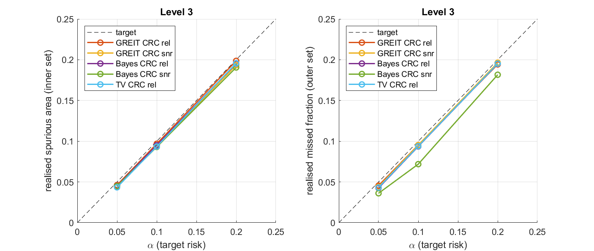

# Conformal EIT: distribution-free guarantees for GREIT-based EIT

MATLAB code for the paper *Distribution-free guarantees for GREIT-based electrical
impedance tomography: conformal anomaly segmentation and error bars robust to
forward-model error* (in preparation).

Conformal risk control is applied on top of unchanged EIT reconstructions (GREIT,
a linear-Gaussian posterior mean, total variation). From phantoms with known ground
truth it calibrates

- **inner and outer anomaly sets** whose expected spurious area and expected missed
  fraction are each at most a chosen level α (replacing the fixed 25%-of-peak threshold);
- **pixel error bars** with separate coverage guarantees on active and background
  pixels and amplitude-adaptive width.

The guarantees hold in finite samples without assumptions on the forward model,
the noise or the reconstruction. The experiments compare them with Bayesian and
Bayesian-approximation-error credible intervals under four levels of forward-model
error, and test them on the open KTC2023 tank dataset.



## Requirements
- MATLAB R2019b or newer (base MATLAB only, no toolboxes)
- [EIDORS 3.11](https://eidors.org)
- Python 3.9 or newer for the segmentation metrics and two of the figures (`conformal_eit/python_metrics/requirements.txt`)

## Setup
1. Clone or download this repository.
2. Download EIDORS 3.11 from <https://eidors.org> and unzip it so that the file
   `lib/eidors/eidors_startup.m` exists inside the repository.
3. *(Optional, for the real-data experiment.)* Download the KTC2023 data (CC BY 4.0):
   - `Codes_Matlab.zip` from <https://zenodo.org/records/10418802>
   - `EvaluationData_full.zip` from <https://zenodo.org/records/10986692>

   Unzip both into `conformal_eit/data/ktc_download/`, giving
   `ktc_download/Codes_Matlab/` and `ktc_download/EvaluationData_full/`.
   They are prepared automatically on the first run.

## Run
From the repository root in MATLAB:
```matlab
run('conformal_eit/main_conformal.m')   % Experiments 1-4; about 2-3 h the first time
run('conformal_eit/run_fig_ktc.m')      % Figure 3 (needs the KTC2023 data)
```
Simulated datasets and operators are cached in `conformal_eit/data/`, so later runs
take a few minutes. Set `QUICK = true` in `main_conformal.m` for a 15–25 min smoke test.
Results (CSV tables and PNG figures) are written to `conformal_eit/results/`; the
versions used in the paper are included in this repository.

The standard segmentation metrics and the final versions of two figures are produced in
Python from the files cached by the MATLAB run (so run MATLAB first):
```
cd conformal_eit/python_metrics
pip install -r requirements.txt
python run_seg_metrics.py        # Table 4, about 2 min
python make_fig_model_error.py   # Figure 3
python make_fig_ktc.py           # Figure 4 (needs the KTC2023 data)
```

## Contents
| Path | Purpose |
|---|---|
| `init_env.m` | loads EIDORS |
| `conformal_eit/main_conformal.m` | runs all experiments |
| `conformal_eit/run_exp3.m` | real-data experiment only |
| `conformal_eit/run_fig_ktc.m` | Figure 3 |
| `conformal_eit/conformal/` | conformal risk control, losses, scores, splits |
| `conformal_eit/recon/` | GREIT operators, Bayesian, BAE and TV baselines |
| `conformal_eit/sim/` | 3D simulation models with model-error levels 0–3, phantoms |
| `conformal_eit/real/` | KTC2023 loader, models, ground-truth registration |
| `conformal_eit/experiments/` | Experiments 1–4, settings (`cfg_default.m`), plots |
| `conformal_eit/python_metrics/` | Python: standard segmentation metrics (Dice, IoU, SSIM, ...) and figure scripts |
| `conformal_eit/results/` | tables and figures from the paper run |

| Paper | Output |
|---|---|
| Figure 1 | method overview, drawn in the manuscript |
| Figure 2 | `results/exp1_validity.png` |
| Figure 3 | `results/exp2_model_error.png` (`python_metrics/make_fig_model_error.py`) |
| Figure 4 | `results/fig_ktc_examples.png` (`python_metrics/make_fig_ktc.py`); the paper version adds a row of photographs of the targets from the KTC2023 paper, which are not redistributed here |
| Tables 1–3 | `results/exp1_segmentation.csv`, `exp2_intervals.csv`, `exp3_ktc_real.csv` |
| Table 4 | `results/exp5_seg_metrics.csv` (`python_metrics/run_seg_metrics.py`) |

## Citation
Citation details will be added on publication.

## License
Code: MIT (see `LICENSE`). EIDORS and the KTC2023 data are not included and keep
their own licences (EIDORS: GPL; KTC2023: CC BY 4.0).
